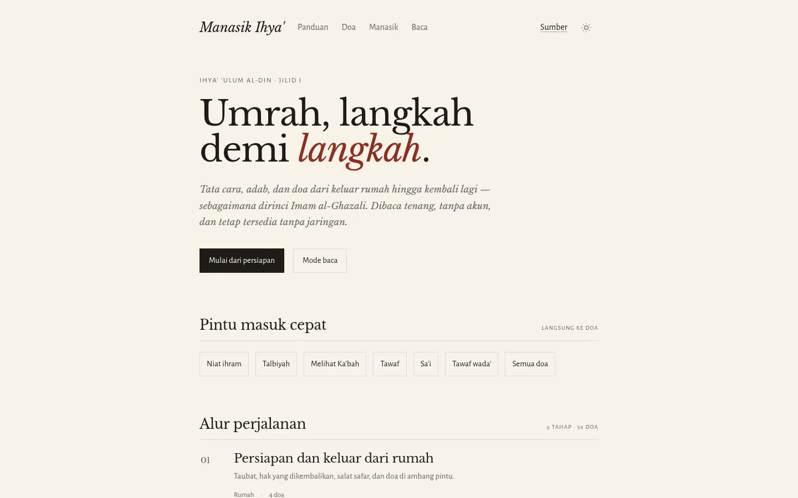
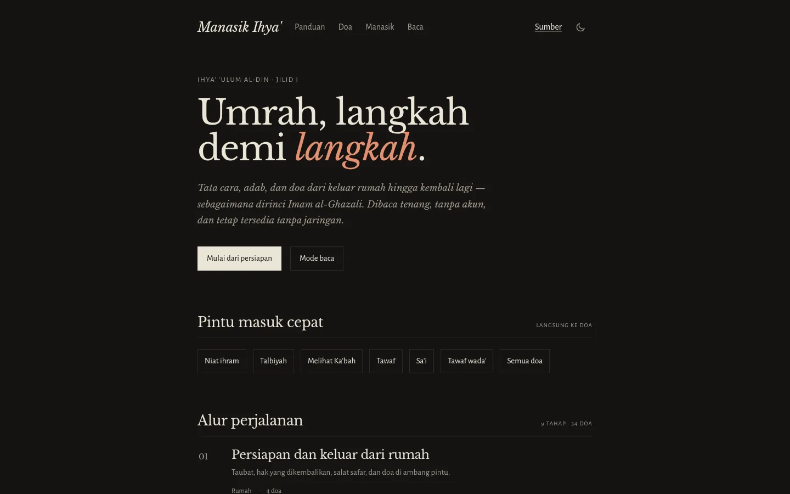
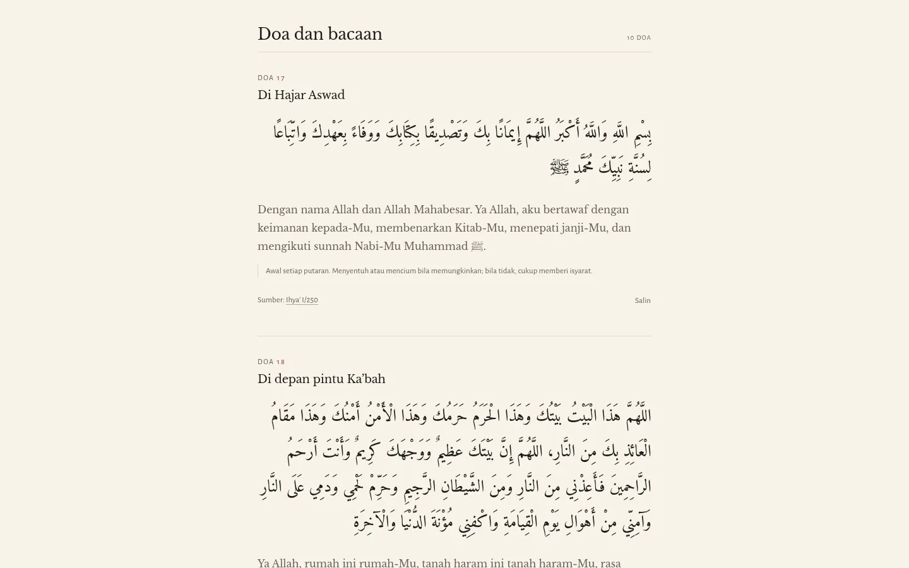
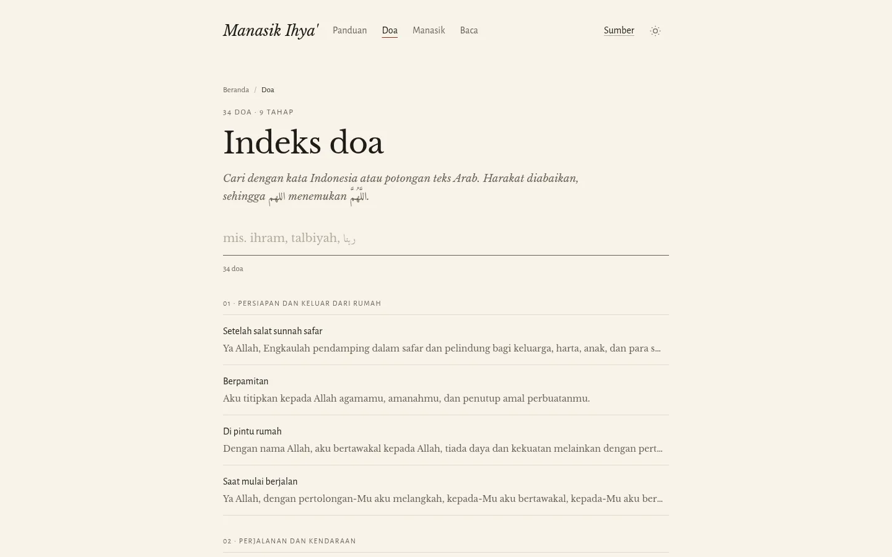
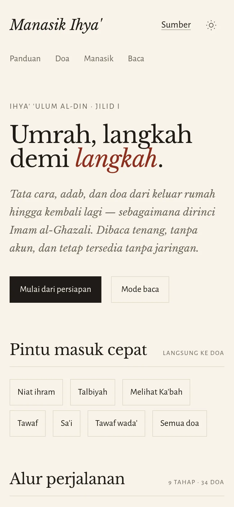
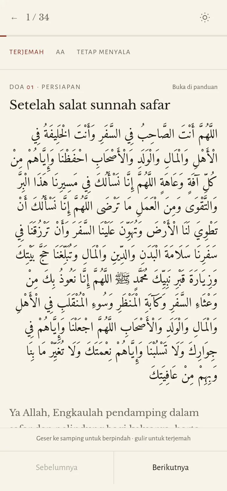
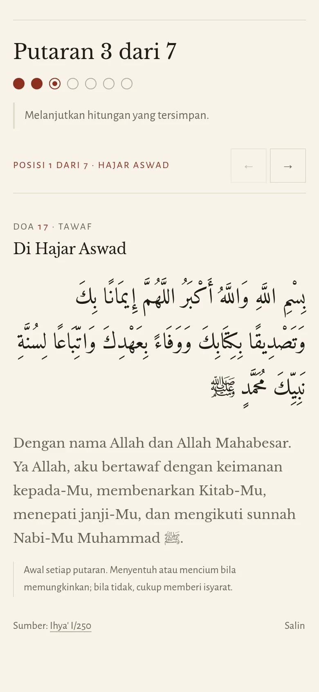
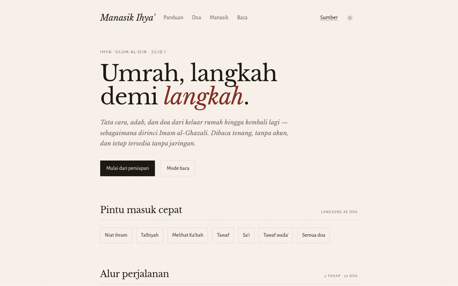

# Manasik Ihya'

Bacaan umrah dari _Ihya' 'Ulum al-Din_ — sembilan tahap, 34 doa, satu sumber.
Situs statis, tanpa akun, tanpa basis data, dan tetap terbaca tanpa jaringan setelah
kunjungan pertama.

```bash
npm install
npm run dev        # http://localhost:4321
npm run build      # validasi isi + build ke dist/
npm run preview    # pratinjau hasil build (termasuk service worker)
```

> Astro 7 menjalankan dev dan preview sebagai proses latar. Kelola dengan
> `npx astro dev status`, `npx astro dev logs`, `npx astro dev stop`
> (sama untuk `astro preview`).

## Tangkapan layar

| Beranda | Mode gelap |
|---|---|
| [](docs/screenshots/beranda-desktop.webp) | [](docs/screenshots/beranda-gelap-desktop.webp) |

| Tahap tawaf — doa dan bacaan | Indeks doa |
|---|---|
| [](docs/screenshots/tahap-tawaf-desktop.webp) | [](docs/screenshots/dua-desktop.webp) |

| Mobile: beranda | Mode baca | Penghitung tawaf |
|---|---|---|
| [](docs/screenshots/beranda-mobile.webp) | [](docs/screenshots/baca-mobile.webp) | [](docs/screenshots/manasik-mobile.webp) |

Demo singkat — beranda, tahap tawaf, mode baca (termasuk sembunyikan terjemah),
lalu penghitung tawaf:

[](docs/demo/manasik-ihya.mp4)

[Unduh video MP4](docs/demo/manasik-ihya.mp4) · 20 detik · 770 KB.

## Skrip

| Perintah | Isi |
|---|---|
| `npm run dev` | Server pengembangan |
| `npm run build` | Menjalankan `validate` lalu membangun situs statis |
| `npm run preview` | Menyajikan `dist/` beserta service worker |
| `npm run validate` | Memeriksa 34 doa, 9 tahap, rujukan 1–19, dan posisi manasik |
| `npm run check` | Pemeriksaan tipe Astro/TypeScript |

## Peta halaman

| Rute | Isi |
|---|---|
| `/` | Beranda: alur 9 tahap, pintu masuk cepat, "Lanjutkan" |
| `/panduan/` | Daftar tahap |
| `/panduan/[slug]/` | Prosa tahap + doa berurutan + penanda selesai |
| `/dua/` | Indeks 34 doa dengan pencarian Arab/Indonesia |
| `/baca/` | Mode baca satu doa per layar (`?tahap=tawaf`, `#dua-...`), toggle terjemah, ukuran teks, wake lock |
| `/itinerary/` | Itinerary pribadi: timeline hari, checklist, kode tersamarkan |
| `/itinerary/edit/` | Editor markdown itinerary, impor/ekspor, template, cadangan |
| `/manasik/` | Pintu masuk penghitung |
| `/manasik/tawaf/` | Penghitung 7 putaran + doa per posisi |
| `/manasik/sai/` | Penghitung 7 lap + arah Shafa–Marwah |
| `/cetak/` | Buku lengkap untuk dicetak / disimpan PDF |
| `/cetak/[slug]/` | Lembar cetak per tahap |
| `/sumber/` | Kitab, catatan editorial, 19 rujukan |
| `/offline/` | Fallback saat halaman belum tersimpan |
| `/404` | Halaman tidak ditemukan (juga `dist/404.html`) |

## Struktur

```
src/
├─ content.config.ts        skema koleksi (zod)
├─ content/stages/*.md      prosa 9 tahap
├─ content/duas/*.md        34 doa (frontmatter: arabic, translation, source, position)
├─ data/sources.ts          19 rujukan + posisi tawaf/sa'i
├─ lib/itinerary.ts         parser markdown itinerary, hari, waktu, tag, artefak
├─ lib/itinerary-progress.ts hash + simpan tanda selesai kegiatan
├─ scripts/itinerary-*.ts   render timeline, halaman baca, editor
├─ lib/content.ts           pengurutan, indeks global, href
├─ lib/text.ts              normalisasi Latin/Arab (harakat dibuang) untuk pencarian
├─ styles/theme.css         token SocratEx, tipografi Arab, cetak
├─ components/              SiteHeader, DuaBlock, Counter, SizeControl, StageRail, …
├─ layouts/BaseLayout.astro tema anti-kedip, preload font, header/footer, slot
├─ scripts/                 home, search, reader, counter, progress
└─ pages/                   rute di atas
public/fonts/               Libre Baskerville, Alegreya Sans, Amiri (+ OFL)
public/icons/               ikon PWA + sumber SVG
scripts/validate-content.mjs
```

## Menambah atau mengubah doa

Buat `src/content/duas/<id>.md`:

```yaml
---
stage: tawaf                 # salah satu slug tahap
order: 3                     # urutan dalam tahap
title: Di Rukun Iraqi
position: rukun-iraqi        # opsional; dipakai penghitung
source: [11]
arabic: |
  اللَّهُمَّ ...
translation: |
  Ya Allah, ...
note: |
  Catatan kecil (opsional).
---
```

Lalu `npm run validate`. Bila doa dipakai penghitung, tambahkan id-nya ke
`tawafStops` / `tawafAfter` / `saiStops` di `src/data/sources.ts` dan ke
`REQUIRED_IDS` pada skrip validasi.

Nomor `source` merujuk `src/data/sources.ts` (1–19). Nomor tampilan doa
(`DOA 18`) dihitung otomatis: urutan tahap lalu urutan doa.

Bila satu doa terdiri dari beberapa bagian (misalnya dzikir, lalu petikan Al-Qur'an, lalu doa),
pisahkan `arabic` dan `translation` dengan satu baris kosong. Jumlah paragraf
keduanya harus sama; setiap pasangan ditampilkan berurutan: Arab, terjemah, Arab,
terjemah. `npm run validate` menolak build bila jumlahnya tidak cocok.

## Catatan kondisi

Setiap tahap dapat punya `note` pada frontmatter (`src/content/stages/*.md`). Catatan itu
tampil sebagai blok “Catatan kondisi” di akhir halaman tahap dan ikut tercetak. Isinya
perbedaan antara urutan naskah dan praktik hari ini — misalnya miqat yang diumumkan di
pesawat, tawaf di lantai atas, atau tahallul di barbershop.

Bedakan dari `note` pada doa: yang itu untuk hal spesifik pada lafaz doa tersebut
(misalnya lafaz “man hajjahu”).

## Sistem visual

Token warna, tipografi, dan komponen mengikuti sistem SocratEx:

- Kertas `#f7f3ea`, tinta `#1f1c17`, satu aksen terakota `#8c2f1f`; mode gelap
  dengan token yang sama.
- Serif untuk membaca (Libre Baskerville), sans untuk bekerja (Alegreya Sans),
  Amiri untuk teks Arab.
- Garis 1px, radius 0, tanpa bayangan; lebar baca 672px, daftar 768px.
- Teks Arab: `dir="rtl"`, `lang="ar"`, harakat utuh, ukuran dasar 1,7rem,
  line-height 2,05. Di mode baca ukuran menyesuaikan panjang doa.

Ukuran teks (Kecil/Sedang/Besar), tema, progres tahap, dan hitungan tawaf/sa'i
disimpan di `localStorage`:

| Kunci | Isi |
|---|---|
| `theme-preference` | `light` / `dark` |
| `manasik:text-size` | `kecil` / `sedang` / `besar` |
| `manasik:translation` | `on` / `off` — tampilkan atau sembunyikan terjemah di mode baca |
| `manasik:progress` | array slug tahap yang ditandai selesai |
| `manasik:last` | slug tahap terakhir yang dibuka |
| `manasik:tawaf`, `manasik:sai` | `{ round, stop, done }` |
| `manasik:itinerary` | markdown itinerary pribadi |
| `manasik:itinerary-updated` | timestamp perubahan terakhir |
| `manasik:itinerary-backup` | cadangan sebelum hapus/impor |
| `manasik:itinerary-progress` | `{ hash: timestamp }` — kegiatan yang ditandai selesai |
| `manasik:mask-codes` | `on` / `off` — samarkan kode pemesanan |

## PWA dan offline

`@vite-pwa/astro` v2 (`AstroPWAIntegration`, named export) memprecache seluruh
halaman, CSS/JS, dan font. Fallback navigasi menuju `/offline`.

Dua pengaturan penting di `astro.config.mjs`:

- `experimental.directoryAndTrailingSlashHandler: true` — agar entri precache
  cocok dengan format direktori Astro (`/baca/` ↔ `baca/index.html`).
- `ignoreURLParametersMatching: [/^tahap$/, /^mode$/]` — agar
  `/baca/?tahap=tawaf` dan `/itinerary/edit/?mode=template` tetap dilayani dari
  cache, bukan jatuh ke halaman offline.
- `globIgnores: ['icons/**', '404.html']` — `404.html` **tidak** boleh masuk
  precache. Build memetakannya menjadi `/404`, dan nginx mengembalikan status 404
  untuk alamat itu; satu respons gagal membatalkan seluruh instalasi service worker.

Footer menampilkan tombol “Pasang aplikasi” saat peramban mengirim
`beforeinstallprompt`, dan petunjuk “Bagikan → Tambah ke Layar Utama” di iOS.
Saat ada build baru, `UpdateNotice` mendeteksi service worker baru dan
menampilkan bar “Versi baru tersedia” dengan tombol **Muat ulang**. Pemeriksaan
juga dilakukan ketika tab kembali aktif, jadi aplikasi yang sudah dipasang
tidak perlu dibersihkan cache-nya secara manual.

Ikon PWA dibuat dari `public/icons/icon.svg` dan `maskable.svg`:

```bash
rsvg-convert -w 512 -h 512 public/icons/icon.svg -o public/icons/icon-512.png
rsvg-convert -w 192 -h 192 public/icons/icon.svg -o public/icons/icon-192.png
rsvg-convert -w 512 -h 512 public/icons/maskable.svg -o public/icons/maskable-512.png
```


## Itinerary pribadi

`/itinerary` adalah notebook lokal untuk rencana perjalanan. Tidak ada akun,
backend, atau data yang dikirim ke server; isinya disimpan di `localStorage`
peramban. Halaman bertanda `noindex` dan tidak masuk sitemap.

Format markdown:

```md
---
nama: Perjalanan Umrah
mulai: 2026-11-17
selesai: 2026-11-28
zona: WITA · WIB · AST
---

## Hari 1 — Selasa, 17 November 2026
- **10:30 WITA** — Berangkat dari rumah.
- **14:00 WIB** — Penerbangan ke Jakarta, kursi `08K`.
- [ ] Paspor
- [ ] Visa

## Hari 5 — Sabtu, 21 November 2026
- **11:15 AST** — Mandi ihram. #ihram
- **22:00 AST** — Tawaf, sa'i, tahallul. #tawaf #sai #tahallul
```

- Parser menerima `10:30`, `10.30`, rentang `10:30–10:45`, zona opsional, dan
  judul `Hari 1` / `Hari ke-1` / `Day 1`.
- `#ihram`, `#tawaf`, `#sai`, `#tahallul`, `#wada` menjadi tautan ke panduan.
- `- [ ]` bisa dicentang dan menulis balik ke markdown.
- Setiap kegiatan berjam punya tombol centang sendiri di kanan baris. Status
  disimpan di `manasik:itinerary-progress` dengan kunci hash
  `judul hari + jam + teks`, jadi markdown tidak berubah. Mengedit teks
  kegiatan mereset status kegiatan itu saja.
- Header hari menampilkan `2/5 selesai` dan tombol **Tandai kegiatan hari ini**
  / **Batalkan kegiatan hari ini**. Ringkasan total dan **Reset progres** ada di
  rail sticky.
- Saat halaman dibuka, itinerary otomatis menggulir ke kegiatan pertama yang
  belum selesai pada hari ini, dengan label **Berikutnya**. Bila semua kegiatan
  hari ini selesai, halaman berhenti di judul hari dan menampilkan **Selesai**.
  Auto-scroll dilewati bila URL punya hash, dan tidak dilakukan bila hari ini di
  luar rentang `mulai`/`selesai`. Karena berbasis progres — bukan jam dinding —
  perilakunya tetap benar untuk rencana lintas zona WITA/WIB/AST.
- Rail hari bersifat sticky (latar `--paper`, garis 1px, tanpa shadow) agar nomor
  hari, ringkasan progres, dan tautan **Berikutnya** tetap terlihat.
- `` `kode` `` disamarkan di halaman baca; ketuk untuk melihat, tombol
  **Salin** menyalin kode asli.
- Tanggal `mulai`/`selesai` menandai **Hari ini**.
- Editor menyediakan impor/ekspor `.md`, template fiktif, dan **Rapikan
  artefak** (NBSP, zero-width, `** 10:30 **`, sisa LaTeX).
- Sebelum hapus/impor/template/rapikan, versi sebelumnya disimpan di
  `manasik:itinerary-backup`; tersedia **Urungkan** dan **Pulihkan cadangan**.
- Progres selesai tidak ikut ekspor `.md`; ekspor hanya berisi rencana.
- `marked` hanya dimuat di rute itinerary; halaman lain tetap ringan.

Jangan menaruh itinerary pribadi (PNR, booking ID, nama) di repo publik.

## Domain dan SEO

`site` di `astro.config.mjs` memakai `SITE_URL` bila ada, dengan cadangan
`https://umrah.ngopikir.com`. Setel sebelum deploy:

```bash
SITE_URL=https://domain-anda.id npm run build
```

Yang sudah disiapkan:

- canonical, Open Graph, dan Twitter Card di setiap halaman; gambar `public/og.png`
  berukuran 1200×630.
- JSON-LD: `WebSite` di beranda, `WebPage` + `BreadcrumbList` di halaman tahap,
  `BreadcrumbList` di halaman indeks. Breadcrumb juga tampil di halaman.
- Sitemap hanya memuat halaman yang boleh diindeks; `/baca`, `/cetak`,
  `/offline`, `/404`, dan `/itinerary` bertanda `noindex` dan tidak masuk
  sitemap.
- `robots.txt` dibuat dari `SITE_URL` (bukan berkas statis), jadi URL sitemap
  selalu ikut domain build.

Catatan hosting: konfigurasi ini mengasumsikan situs berada di **akar domain**
(Cloudflare Pages, Netlify, Vercel, atau custom domain). Bila memakai GitHub Pages
pada subpath `/<repo>/`, aset absolut (`/fonts`, `/baca`) perlu `base` dan
penyesuaian `BASE_URL`.

## Sumber dan etika isi

Ringkasan dan lafaz mengikuti _Ihya' 'Ulum al-Din_ jilid I (dan jilid II untuk
satu rujukan), dengan nomor halaman pada daftar sumber. Dua catatan editorial:

1. Doa mendekati Ka'bah pada naskah sumber terpotong elipsis; setelah diperiksa,
   bagian itu adalah keterangan "lalu ia mengangkat kedua tangannya", bukan
   lafaz yang hilang. Doa disajikan dalam dua bagian.
2. Lafaz "man hajjahu" pada doa melihat Ka'bah dibiarkan apa adanya, dengan
   catatan ringkas di doa tersebut.

Panduan ini bukan fatwa. Jangan menambahkan doa, waktu, atau hitungan yang tidak
ada di sumber tanpa catatan yang jelas.

## Tanpa pelacakan

Tidak ada analitik, cookie, atau permintaan pihak ketiga. Semua font disajikan
dari domain sendiri. Satu-satunya penyimpanan adalah `localStorage` di peramban
pembaca.
